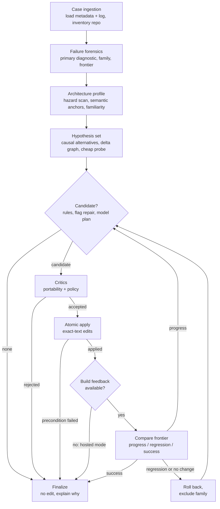
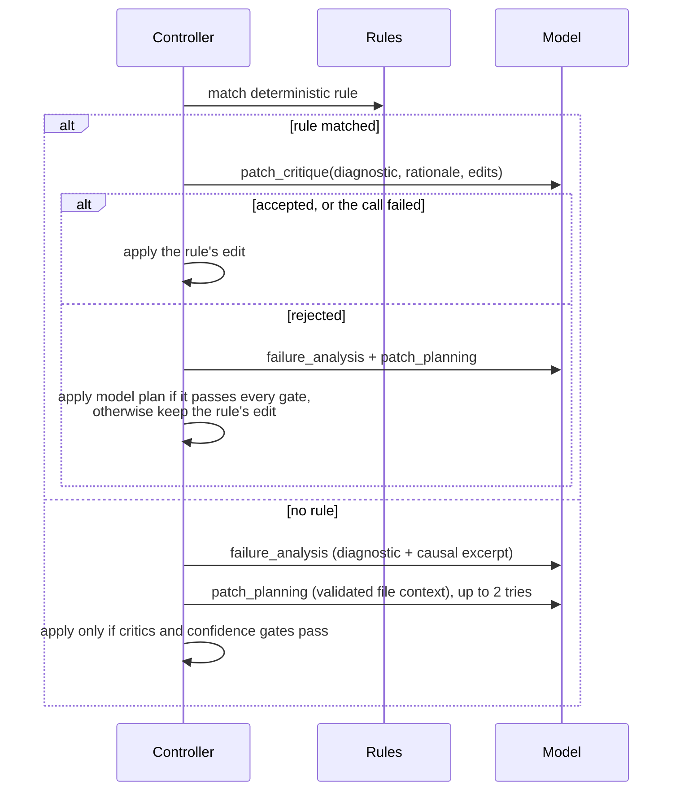

# Archimedes — Codebase Guide

Archimedes is an autonomous **Repair Agent** for the
[Build-Bench Challenge](https://matrix.cstcloud.cn/build-bench/). It is handed a
software package that builds on one CPU architecture but fails on another
(x86_64 ↔ aarch64), together with the failing build log. It then works out why
the build failed and edits the package source so that the build succeeds on the
target architecture.

This guide explains the whole repository: what problem it solves, how the
code is organised, how a single run works from start to finish, how each
subsystem makes its decisions, and how to install, test, package and submit it.
It is written to be read top to bottom, but every section also stands on its own.

> **Status (5 November 2026).** Version **0.2.20** is the confirmed final
> submission (`20261105T144419Z-2225a4ad`, SHA-256 `2cb11d01…6764b`). It passed
> the organizer's Hosted Smoke Test 1/1. The confirmation is irreversible; the
> organizers run the Full Evaluation themselves. See [`SUBMISSION.md`](../SUBMISSION.md).

---

## Contents

1. [The problem in plain terms](#1-the-problem-in-plain-terms)
2. [Key terms](#2-key-terms)
3. [Repository layout](#3-repository-layout)
4. [Installation and setup](#4-installation-and-setup)
5. [Running things](#5-running-things)
6. [How one run works, end to end](#6-how-one-run-works-end-to-end)
7. [Subsystems in depth](#7-subsystems-in-depth)
8. [How the language model is used](#8-how-the-language-model-is-used)
9. [Safety and competition compliance](#9-safety-and-competition-compliance)
10. [Configuration reference](#10-configuration-reference)
11. [Outputs reference](#11-outputs-reference)
12. [Testing and development tooling](#12-testing-and-development-tooling)
13. [Release and submission process](#13-release-and-submission-process)
14. [Extending the Agent: adding a repair rule](#14-extending-the-agent-adding-a-repair-rule)
15. [Known limitations](#15-known-limitations)
16. [Troubleshooting](#16-troubleshooting)

---

## 1. The problem in plain terms

Linux distributions build the same source package for many CPU architectures.
A package that builds cleanly on x86_64 (Intel/AMD) can fail on aarch64 (ARM),
and vice versa. Typical reasons:

- the build passes an x86-only compiler flag such as `-msse` or `-mavx2`;
- the source includes an x86-only header such as `immintrin.h`;
- a packaging file hard-codes `x86_64-linux-gnu` library paths;
- the list of exported library symbols differs between architectures;
- a test or a link step assumes 64-bit atomics, pointer width or byte order.

Build-Bench packages each such failure as a **Case**. For every Case the
organizer runs the submitted Agent inside an isolated container, then takes the
Agent's edits as a patch, applies the patch to a clean copy of the package, and
runs the real target-architecture build. **A Case counts as repaired only if
that official build succeeds.** There is no credit for a patch that merely
looks right.

The Agent therefore has to be **accurate** (a wrong edit gains nothing) and
**honest** (the rules forbid suppressing failures, deleting tests or faking
artifacts). Archimedes is built around both requirements: it edits only when it
can justify the edit from evidence, and it leaves the package untouched when it
cannot.

### The runtime contract

Each run receives three directories (the official "workspace"):

```text
/workspace/input/       read-only: case.json metadata and the failing build log
/workspace/work/repo/   writable: the package source tree to repair
/workspace/output/      writable: agent-result.json and diagnostics
```

The Agent must be deterministic and non-interactive. It must not start Docker,
contact the Validator, or read hidden Case data. It reports its outcome in
`output/agent-result.json`; the platform derives the patch from whatever
changed under `work/repo/`.

---

## 2. Key terms

| Term | Meaning |
|---|---|
| **Case** | One build failure: package source, metadata (`case.json`) and the failing target-architecture log. |
| **Source / target architecture** | The architecture the package is known to build on, and the one where it fails. |
| **Worktree** | The writable package tree at `work/repo/`. |
| **Canonical patch** | The Git-style diff the platform derives from the worktree after the Agent exits. |
| **Validator** | The organizer's container that applies the patch and runs the official build. |
| **Hosted Smoke Test** | The organizer's qualification run on a tiny Case set. It checks packaging, model access and the output contract. It does not produce a score. |
| **Full Evaluation** | The organizer-run scoring over roughly 1,000 hidden Cases. |
| **Starter Kit** | The official toolkit (`bb` command, runner, Docker images, schemas) used to test and package Agents. Current version: `0.1.0-rc.5`. |
| **OBS / sbuild** | The two build systems seen in logs: openSUSE Build Service (RPM, hosted Smoke Cases) and Debian/Ubuntu `sbuild` (Launchpad Cases). |
| **Failure family** | The Agent's classification of the root failure: compilation, linking, dependency, configuration, packaging, test, artifact, environment, build preparation or unknown. |
| **Failure frontier** | How far the build got before failing, as an ordered stage (environment → dependency → configure → compile → link → install → package → test → artifact validation → success). A repair that moves the frontier forward is progress even if the build still fails. |
| **Error signature** | A normalised form of the primary diagnostic (paths, numbers and temp names replaced) so two failures can be compared across attempts. |
| **Evidence item** | One observed fact with a source, a reliability and a strength. Examples: a compiler diagnostic, a line read from a file. |
| **Claim** | A statement the Agent believes, backed by evidence items, with a fused confidence and a status. |
| **Hypothesis** | A candidate explanation of the failure, each tied to a repair family and to conditions that would falsify it. |
| **Hazard** | An architecture-specific construct found by static scanning: an x86 flag, an intrinsic header, inline assembly, an architecture macro, an ABI assumption. |
| **Semantic anchor** | A conservative "what does this construct mean?" record for a hazard. A flag-removal repair is allowed only when the construct is clearly an optimisation and not package behaviour. |
| **Deterministic rule** | A hand-written repair that fires only on unique, specific log and file evidence. Most of the Agent's actual edits come from these rules. |
| **Repair family** | The kind of fix a candidate represents (conditional compiler flag, packaging rule, atomic linkage, …). |
| **Candidate** | A proposed set of exact text edits plus its rationale, confidence and risk. |

---

## 3. Repository layout

```text
archimedes/
├── agents/
│   ├── archimedes/              ← the Repair Agent (this is what gets submitted)
│   │   ├── agent.yaml           manifest: name, version, runtime profile, entrypoint
│   │   ├── requirements.lock    pinned deps (empty: standard library only)
│   │   ├── README.md            Agent-level design notes and version history
│   │   └── src/                 all Agent code (≈7,300 lines, 75 files)
│   └── example-agent/           organizer's read-only reference Agent
├── tests/                       200 unit/integration tests (not submitted)
├── dev/                         development tools and synthetic Cases (not submitted)
│   ├── synthetic_cases/         16 small hand-built failure scenarios
│   ├── evaluate.py              runs ablation configurations A–K over synthetic Cases
│   ├── configurations.json      the A–K experiment definitions
│   ├── replay_development_cases.py  replays the Agent over the 200 public Cases
│   ├── package_worktree_bundle.py   builds a Development Validation upload bundle
│   ├── submission_preflight.py      readiness gates: archive freshness, ready result, digests
│   └── trace_viewer.py              renders execution-trace.jsonl as HTML
├── docs/
│   ├── CODEBASE_GUIDE.md        this document
│   └── README.md                documentation reading order
├── runner/, templates/, bb      Starter Kit runtime and command (never modified)
├── example-cases/               organizer's released example Case (hello)
├── dist/                        built submission ZIPs (generated)
├── runs/                        local run evidence (generated, git-ignored)
├── README.md                    project overview and current status
├── SUBMISSION.md                release, portal and evidence record
└── COMPETITION_AUDIT.md         audit of the official participant contract
```

### Inside `agents/archimedes/src/`

| Package | Responsibility |
|---|---|
| `main.py` | Process entry point: resolves the workspace, loads config, wires dependencies, runs the controller, writes the result, maps errors to exit codes. |
| `config.py` | Reads and validates every environment setting into an immutable `RuntimeConfig`. |
| `constants.py` | Version, size limits, evidence reliabilities, candidate-ranking weights. |
| `schemas.py` | Shared dataclasses and enums (the vocabulary of the whole system). |
| `workspace/` | Workspace paths, bounded Case/log loading, repository inventory, tool discovery, and the **path policy** that decides which files may be edited. |
| `forensics/` | Reads the build log: normalisation, primary-diagnostic selection, failure classification, error signatures, failure frontier. |
| `architecture/` | Static hazard scanning, semantic anchors, architecture profile, familiarity scoring, discovery, aliases, cheap probes. |
| `evidence/` | The evidence ledger, confidence fusion and the patch-gating policy. |
| `reasoning/` | The **controller** (the state machine that runs everything), hypothesis generation, candidate ranking, probe planning. |
| `repair/` | Deterministic repair rules, candidate construction, the portability and policy critics, and the atomic edit executor with rollback. |
| `models/` | OpenAI-compatible HTTP client, budgeted router, strict JSON response contracts, task prompts, mock client for tests. |
| `build/` | Optional build-feedback providers (disabled in hosted evaluation). |
| `context/` | Bounded repository search, snippet selection, token budget accounting. |
| `graph/` | A small causal "delta graph" linking failure tokens to repository hazards. |
| `memory/` | Per-run episode memory (no cross-Case persistence). |
| `knowledge/` | Small JSON tables: architecture aliases, failure patterns, portability rules. |
| `observability.py`, `logging_utils.py`, `metrics.py`, `result_writer.py` | Trace events, structured logging, metrics, atomic output writing. |
| `errors.py`, `json_safety.py` | Typed error hierarchy and defensive JSON parsing helpers. |

---

## 4. Installation and setup

### 4.1 Prerequisites

| Requirement | Why | Notes |
|---|---|---|
| Python **3.11** | Matches the managed runtime (`python:3.11.9-slim-bookworm`). | Newer Pythons work for development; always confirm in 3.11 before release. |
| Git | Source control. | |
| Linux with **Docker Engine** | The `bb` commands run the Agent and Validator in containers. | On Windows, use **WSL 2 (Ubuntu)** with Docker available inside WSL. |
| Bash, GNU coreutils | `bb` is a Bash script. | |
| mypy, ruff, pytest (dev only) | Static checks and tests. | Not needed by the Agent itself. |

The Agent has **no third-party Python dependencies**. `requirements.lock`
contains only a comment, which satisfies the "pin every dependency with `==`"
rule trivially.

### 4.2 Clone and create a development environment

```bash
git clone <your-repo-url> archimedes
cd archimedes
python3.11 -m venv .venv
source .venv/bin/activate            # Windows PowerShell: .venv\Scripts\Activate.ps1
pip install mypy ruff pytest
```

### 4.3 Get the official Starter Kit

Download `buildbench-starter-kit-0.1.0-rc.5.zip` from the
[Data & Downloads](https://matrix.cstcloud.cn/build-bench/data-downloads.html)
page and verify it against the published `SHA256SUMS`.

**Important on Windows/WSL:** extract and run the kit from your WSL **home
directory** on the ext4 filesystem (for example `~/bbkit/`), **not** from
`/tmp` and not from a `/mnt/c` or `/mnt/e` path. `/tmp` is mounted `nodev` in
WSL, and the Validator's nested build chroot then fails with
`/dev/null: Permission denied`. This failure comes from the environment, not
from the Agent.

```bash
mkdir -p ~/bbkit && cd ~/bbkit
unzip /path/to/buildbench-starter-kit-0.1.0-rc.5.zip
cd buildbench-starter-kit-0.1.0-rc.5
./bb doctor        # checks Git, Docker and the pinned images
./bb demo          # runs the official failure-to-success example
```

### 4.4 Optional: the public Development Cases

The 200 public Cases (`buildbench-development-cases-v0.1.zip`, 222,919,777
bytes, SHA-256 `94372a28…bd675d`) are useful for measuring the Agent. Five
Debian file names contain colons, so extract the ZIP **inside WSL/Linux**:

```bash
mkdir -p ~/bbdata && cd ~/bbdata
curl -LO https://matrix.cstcloud.cn/build-bench/releases/training-set/v0.1/buildbench-development-cases-v0.1.zip
sha256sum buildbench-development-cases-v0.1.zip
mkdir d1 && cd d1 && python3 -c "import zipfile;zipfile.ZipFile('../buildbench-development-cases-v0.1.zip').extractall('.')"
```

To unpack the Debian source packages without root access, download and extract
the Ubuntu tooling into a local folder:

```bash
mkdir -p ~/bbtools && cd ~/bbtools
apt-get download dpkg-dev libdpkg-perl bzip2
for deb in *.deb; do dpkg-deb -x "$deb" root; done
```

---

## 5. Running things

### 5.1 Fast local checks (from the repository root)

```bash
python -m unittest discover -s tests -t .      # or: python -m pytest -q
python -m mypy --strict agents/archimedes/src
python -m ruff check agents/archimedes/src tests dev
```

The expected state is 200 tests passing (two symlink tests skip on Windows),
strict mypy clean over 75 files, and no new ruff findings.

### 5.2 Run the Agent by hand on a workspace

The entry point reads `BB_WORKSPACE` (default `/workspace`):

```bash
mkdir -p /tmp/ws/input /tmp/ws/work/repo /tmp/ws/output
cp my-case.json /tmp/ws/input/case.json
cp failing-build.log /tmp/ws/input/initial-build.log
cp -r package-source/. /tmp/ws/work/repo/

cd agents/archimedes
BB_WORKSPACE=/tmp/ws python -m src.main
cat /tmp/ws/output/agent-result.json
```

With no model settings, the Agent runs in **mock** mode: it uses only
deterministic analysis and rules and makes no network calls. This is the
recommended mode for development.

### 5.3 Run through the official kit

```bash
cd ~/bbkit/buildbench-starter-kit-0.1.0-rc.5
rm -rf agents/archimedes && mkdir agents/archimedes
(cd /path/to/archimedes/agents/archimedes && \
  tar --exclude=__pycache__ -cf - agent.yaml requirements.lock README.md src) \
  | tar -xf - -C agents/archimedes
./bb ready --agent ./agents/archimedes --json
```

`bb ready` snapshots the Agent, runs the static checks, runs the example Case
end to end (initial failure → Agent → patch → final validation) and writes
`dist/agent-submission.zip`. Treat it as successful only when **all** of these
hold: exit code 0, `"status": "succeeded"`, the ZIP exists, and its SHA-256
matches the reported artifact.

### 5.4 Replay over the 200 public Cases

`dev/replay_development_cases.py` prepares each Case's workspace, unpacks the
Debian source with `dpkg-source -x`, runs the Agent and records which files
changed. As written, it runs from **Windows** and calls `dpkg-source` through
`wsl.exe -d Ubuntu`, so the dataset and tools must be reachable from both sides:

```powershell
python dev/replay_development_cases.py `
  --dataset-root runs/d1/buildbench-development-cases-v0.1 `
  --output-root  runs/development-replay `
  --dpkg-source-root runs/tools/dpkg-dev/root `
  --python C:\path\to\python3.11.exe --jobs 6
```

To run it natively inside Linux instead (recommended, because the five
colon-named files then stay intact on ext4), use a small wrapper that imports
the module and replaces `_extract_debian_source` with a direct `dpkg-source -x`
call. Run that call with `PERL5LIB=~/bbtools/root/usr/share/perl5` and
`PATH=~/bbtools/root/usr/bin:$PATH`, then call `main()` with the same
arguments. That is how the v0.2.20 replay was produced.

A replay measures **what the Agent changes**, not whether the package builds.
Only the organizer's Development Validation service (or the optional local
Validator bundles) can confirm a target build.

---

## 6. How one run works, end to end

### 6.1 Process start (`main.py`)

1. Configure safe logging, then resolve the workspace from `BB_WORKSPACE`.
2. Load `RuntimeConfig` from the environment (§10). Malformed settings raise a
   `ConfigurationError`.
3. Discover which helper executables exist (`CapabilityRegistry`). Nothing is run
   at this point.
4. Choose a build-feedback provider. Feedback is **always disabled in hosted
   mode**, because the rules do not let Agents request official builds.
5. Create the model router. It is `None` in mock mode.
6. Run the `RepairController`, then write `output/agent-result.json` atomically.

Exit codes: `0` completed (with or without an edit), `1` a known Agent error
such as invalid config or fatal hosted model failure, `2` an unexpected
internal error. On failure, the Agent still tries to write a `"failed"` result
document.

### 6.2 The controller pipeline

`reasoning/controller.py` is a linear state machine with a bounded repair
loop. Every stage transition is written to the execution trace.



The same steps in words:

**1. Case ingestion.** `load_case` reads `case.json` (size- and depth-limited,
non-finite numbers rejected) and finds the failure log. It looks first at the
documented metadata fields (`task.initial_failure_evidence`,
`paths.target_failure_log`, …), then at the conventional names
(`initial-build.log`, `logs/target-failure.log`, `build.log`, …). Logs over
2,000,000 characters keep their head and tail, since setup context and the
terminal error are what matter. Architectures are canonicalised through an
alias table (`arm64` → `aarch64`, `amd64` → `x86_64`). An unknown
architecture stays `UNKNOWN`; the Agent never guesses it. The repository is
inventoried into build files, packaging files and ordinary files.

**2. Failure forensics.** `analyze_build_log` finds the **primary diagnostic**:
the first line that actually caused the failure, which is not necessarily the
last line printed. It assigns a failure family and frontier stage, extracts a
causal file when possible, and computes a normalised error signature (§7.2).

**3. Architecture profile.** The hazard scanner reads every text file (up to
2 MB each, no execution) looking for architecture-specific constructs. Each
hazard becomes a high-reliability evidence item, and each one gets a semantic
anchor (§7.3). A familiarity score decides whether the target is well
understood. When it isn't, the Agent switches into a more conservative
"discovery" mode instead of guessing.

**4. Hypotheses.** `generate_initial_hypotheses` creates real alternatives only
when the evidence is ambiguous. One example: "the flag comes from the package
Makefile" versus "it comes from the environment". It does not pad a cause that
is already clear. A one-off repository search probe runs for atomic-symbol
failures to tell "missing `-latomic`" apart from "project-defined atomic
helpers".

**5. Candidate generation** (`_candidate_for`), tried in order:

1. **Deterministic rules** (`repair/deterministic.py`), if one matches uniquely.
2. **Conditional compiler-flag repair**, for a single x86 flag rejected by a
   non-x86 compiler. It needs three high-consequence claims (flag provenance,
   target incompatibility, semantics preserved) to pass the confidence gate.
3. **Model-planned repair**, only when a model is configured (§8).

In hosted mode, a deterministic candidate is also sent to the model for
critique before it is applied (§8.2).

**6. Critics.** The portability critic rejects candidates below 0.80
confidence, unguarded architecture flags, SSE flags enabled for aarch64, and
exact-name target-triple comparisons. The policy critic rejects forbidden
paths, file deletion, emptied test files and bypass patterns (`skip`, `xfail`,
`disable tests`, `dummy artifact`, `curl`, `sudo`, `docker.sock`, …).

**7. Atomic apply.** Every edit carries the exact text it expects to replace.
All edits are validated in memory first: one operation per file, the expected
text present exactly once, UTF-8, not binary. Only then is each file written
atomically (temp file, `fsync`, `os.replace`). Any failure leaves the tree
unchanged. Each applied edit records before/after hashes so it can be rolled
back.

**8. Build experiment (optional).** If a build-feedback provider exists, the
patch is worth testing, and budget remains, the Agent requests a build and
compares frontiers. A regression or "no change" rolls the edit back and
excludes that repair family. Progress keeps the edit and loops for the next
candidate (up to `ARCHIMEDES_MAX_REPAIR_ATTEMPTS`, default 3). Success stops.
**In the official hosted evaluation this stage is always skipped**, so exactly
one evidence-supported repair (or none) is applied.

**9. Finalize.** The run writes the result, the evidence ledger, the
architecture constitution, the repair episode and metrics, then returns.

---

## 7. Subsystems in depth

### 7.1 Workspace (`workspace/`)

- **`paths.py`** resolves `input/`, `work/repo/` and `output/` and refuses a
  workspace whose directories are missing or escape the root.
- **`case_loader.py`** handles both the flat Starter Kit task format and the
  released `buildbench.case.v0.1` format, where architectures are nested under
  `platform`. When the runner omits architecture fields, it may recover only the
  documented identity fields from a schema-validated `case.json` at the
  worktree root; input metadata always takes priority.
- **`repository_files.py`** iterates repository files deterministically (sorted,
  at most 20,000 files), skipping `.git`, `.hg`, `.svn`, `node_modules` and
  `__pycache__`.
- **`capabilities.py`** records which executables are on `PATH` without running
  them.
- **`path_policy.py`** is the single authority on what may be edited (§9).

### 7.2 Forensics (`forensics/`)

Choosing the right line out of a log of tens of thousands is the foundation
for everything after it.

**Normalisation (`normalize_log`).**

- Strips ANSI colour codes and NUL bytes, and caps line length at 10,000.
- Removes timestamps and `stdout:`/`error:` prefixes.
- Collapses consecutive identical lines into `… [repeated N times]`.
- OBS logs prefix each line with an elapsed time (`[  42s]`). The Agent strips
  only that prefix and deliberately keeps rpmbuild's own `error:` lead-in,
  because on OBS that lead-in is part of the diagnostic.

**Primary diagnostic selection (`identify_primary_diagnostic`).**

- Every line is scored against an ordered table of weighted patterns.
  Examples: `undefined reference` (linking), `fatal error: … No such file`,
  `unrecognized command-line option`, `dpkg-gensymbols: error`, inactivity
  timeouts, OOM kills, rpm stage errors, Debian/RPM dependency phrases, and
  meson/gtest/Go test failures.
- The highest-weight match wins, with a small bonus for appearing early, so
  the *first* cause beats its downstream echoes.
- Lines that look like errors but are not causal are filtered out: `make: ***`
  wrappers, Python logging records, and OBS build-root noise such as chkstat
  ownership warnings, failed `%post` scriptlets and the final host status
  lines.
- When an OBS log contains `----- building X.spec (user abuild)`, the scan
  starts there, so preparation noise before the real build is ignored.
- If nothing matches, it falls back to the last non-noise line.

**Classification (`failure_classifier.py`).** The diagnostic, plus a filtered
context window, is matched against family signal lists (dependency, packaging,
linking, compilation, test, environment, …). Noise lines are excluded from that
context so they cannot "lend" a family.

**Error signature (`error_signature.py`).** Paths, numbers, hex and temporary
names are replaced with placeholders. For example, `error: Bad exit status from
/var/tmp/rpm-tmp.Xy12 (%build)` becomes `error: bad exit status from <temp>
(%build)`. Identical failures across attempts then compare as equal.

**Frontier (`frontier.py`).** The family maps to an ordered stage.
`compare_frontiers(before, after)` returns `success`, `progress` (later
stage), `regression` (earlier stage), `ineffective` (same stage, same
signature) or `partial_progress` (same stage, different signature).

### 7.3 Architecture analysis (`architecture/`)

**Hazard scanner.** Bounded regex scanning (no execution) for six categories,
each with a base confidence:

| Category | Examples | Confidence |
|---|---|---|
| `compiler_flag` | `-msse4.2`, `-mavx2`, `-march=…`, `-mfpu=…` | 0.88 |
| `architecture_macro` | `__x86_64__`, `__aarch64__` | 0.86 |
| `packaging_conditional` | `%ifarch`, `target_arch` | 0.82 |
| `intrinsic_header` | `immintrin.h`, `arm_neon.h` | 0.92 |
| `inline_assembly` | `__asm__ volatile (` | 0.76 |
| `abi_assumption` | `sizeof(long)`, `__int128`, endianness words | 0.68 |

**Semantic anchors.** For each hazard, `extract_anchor` records what the
construct is for: purpose, inputs and outputs, invariants, optimisation
intent, the architecture-specific mechanism, portable alternatives, and
uncertain assumptions. `validate_anchor` lists the gaps that make an edit
unsafe. The flag repair, for instance, is refused unless the anchor shows the
flag is an optimisation and not behaviour the package depends on. This stops
"translate the instruction name" style fixes that compile but change meaning.

**Profile, familiarity and discovery.**

- `construct_profile` collects what is actually known about the target:
  identity, compiler family, pointer width and so on.
- `assess_familiarity` blends eight weighted components into a score from 0
  to 1:
  - architecture identity;
  - metadata completeness;
  - toolchain evidence;
  - repository coverage;
  - portable-rule coverage;
  - knowledge coverage;
  - semantic analogy;
  - model agreement.
- The score falls into one of three bands:
  - **familiar:** 0.80 or above;
  - **moderate:** 0.60 or above;
  - **unfamiliar:** below 0.60, which turns on discovery mode.
- Discovery (`discover_from_static_evidence`) fills in facts only from
  metadata, logs and repository conditionals. For an unknown target with no
  safe candidate, the run records `no_safe_fix` instead of guessing.

### 7.4 Evidence and confidence (`evidence/`)

This is the Agent's core discipline: **edits are justified by claims, claims by
evidence, and evidence carries a source-dependent reliability.**

Reliabilities (`constants.py`):

| Source | Reliability |
|---|---|
| Provided metadata | 0.99 |
| Direct file observation | 0.98 |
| Compiler diagnostic | 0.97 |
| Tool result | 0.95 |
| Repository structure | 0.90 |
| Cross-architecture comparison | 0.85 |
| Portability rule / authoritative knowledge | 0.82 |
| Heuristic | 0.72 |
| Model agreement | 0.65 |
| LLM inference | 0.45 |
| Guess | 0.30 |

**Fusion (`fuse_confidence`).**

1. Support and contradiction are each combined as independent evidence:
   `1 − ∏(1 − reliability × strength)`.
2. The two are blended into `raw = 0.5 + 0.5 × (support − contradiction)`,
   clamped to the range 0.01–0.99.
3. Hard caps apply:
   - a claim supported **only** by model output is capped at **0.65**;
   - a claim supported only by heuristics is capped at **0.75**.
4. The claim's status follows from the result:
   - **contradicted:** strong contradiction that outweighs the support;
   - **confirmed:** at least 0.90 with non-LLM support;
   - **supported:** otherwise, when any support exists;
   - **open:** no support at all.

**Gating (`claim_justifies_patch`).** The confidence needed to act depends on
how much damage a wrong claim could do:

| Consequence | Minimum confidence |
|---|---|
| Critical | 0.90 |
| High | 0.80 |
| Low / medium | 0.60 |

Contradicted claims never justify a patch. Because of the 0.65 cap, a model's
opinion alone can never justify a high-consequence edit. The model must be
corroborated by direct file evidence, such as validated edit preconditions,
and by the log.

### 7.5 Reasoning (`reasoning/`)

- **Controller:** the state machine described in §6.
- **Hypotheses:** an ordered set with priors and posteriors. Build feedback can
  *support*, *falsify* or *select* a hypothesis.
- **Candidate ranker:** scores candidates with fixed weights:
  - critical-claim confidence 0.25;
  - causal coverage 0.20;
  - semantic preservation 0.15;
  - expected frontier gain 0.15;
  - source preservation 0.10;
  - rule support 0.10;
  - minimality 0.05.

  Risk is subtracted from the total. Ties break on confidence, then ID, so
  ranking is deterministic.
- **Probe planner:** chooses cheap, side-effect-free probes by expected
  information gain per cost.

### 7.6 Repair (`repair/`)

**Deterministic rules** live in `deterministic.py` and are tried in a fixed
order. Every rule follows the same pattern:

1. Require a **specific log signal**, not just a failure family.
2. Find the **unique** causal text in the repository.
3. Produce exact-text edits; if anything is ambiguous, return `None`.

| Rule | Fires when the log shows… | Edit it makes |
|---|---|---|
| Debian multiarch path | a missing path containing the *source* triplet (`x86_64-linux-gnu`), or a CMake package not found via a hard-coded `_DIR` | Replace the triplet in `debian/rules` with `$(shell dpkg-architecture -qDEB_HOST_MULTIARCH)`, or in compat-13 `.install` files with `${DEB_HOST_MULTIARCH}`. |
| **Debian symbols** (new in 0.2.20) | `dpkg-gensymbols: error: some symbols or patterns disappeared` plus its diff | Tag exactly the reported symbols `arch=!<target>` (or drop the target from a positive `arch=` list; dpkg's `#MISSING:` marker when only the target was listed). Refuses when a symbol can't be found exactly once, the log architecture disagrees with the Case, or more than 25% (max 200) of a file's symbols vanished. |
| Autoconf x86 flags | `unrecognized command-line option '-msse…'` on a non-x86 target | Remove exactly the rejected flags from the single causal `configure.ac`/Makefile declaration. |
| Unconditional build abort | an `echo "…" >&2; exit 1` whose own message appears in the log | Replace the abort with a comment. This is the Hosted Smoke `hello` repair. |
| CMake feature check | `-mavx…`/`-msse…` plus "does not support" | Wrap the flag in `check_c_compiler_flag`. |
| CMake portable source | missing `x86intrin.h`/`immintrin.h` | Select the existing generic source file instead of the x86 one. |
| Atomic linkage | ``undefined reference to `__atomic…`` | Link the atomic runtime library for the affected target. |
| RPM condition | `Installed (but unpackaged)` or a missing header in a `.spec` | Adjust the architecture condition in the spec. |
| Artifact path | `expected artifact missing at …` | Correct the hard-coded output path. |
| Generated config | `generated architecture mismatch` | Expose the x86 marker only when compiling for x86_64. |
| Architecture guard | `unsupported architecture selection` | Replace a source-only rejection with pointer-width semantics. |
| Source fallback | a compile error in an architecture-specific `.c` file with a portable sibling | Route the build to the existing portable implementation. |
| Portable ABI / bytes | `network-order bytes differ`, `pointer width must be eight` | Use explicit byte serialisation or the correct width type. |
| Synchronized dispatch | ``undefined reference to `optimized_…`` | Keep the CMake source list and dispatch guard consistent. |

On the 200 public Development Cases, version 0.2.20 modifies **15**:

- 4 through the earlier rules (node-re2, buteo-sync-plugins, rocm-llvm,
  qmidiarp);
- 11 through the symbols rule.

dpkg's own `Dpkg::Shlibs::SymbolFile::get_lost_symbols` confirmed every
symbols edit: it removes the target-architecture failure and leaves checking
on other architectures unchanged.

**Candidate construction (`planner.py`).**

- Wraps rule matches, flag repairs and model plans into `PatchCandidate`
  objects.
- Model plans are validated structurally: 1–5 edits, allowed operations only
  (`replace_lines`, `insert_before`, `insert_after`, `create_file`), paths
  accepted by the path policy, and `expected_text` present exactly once.

**Executor (`executor.py`).** Applies all edits or none, atomically, and
supports exact rollback that refuses to overwrite files modified since. It
allows **one operation per file**, so rules that change several places in a
file compose them into a single edit.

### 7.7 Models (`models/`), context (`context/`), graph, memory

- **`openai_compatible.py`** is a small HTTP client built on `urllib` (no
  SDK). It is covered in §8.
- **`router.py`** chooses the FAST or STRONG tier. STRONG is used only when an
  explicit escalation signal fires, such as low critical confidence, an unknown
  target with no evidence, or sample disagreement. The router enforces the
  call, strong-call, token and optional cost budgets before every call.
- **`json_protocol.py`** defines the required keys for each task and rejects
  malformed answers:
  - failure analysis: `claims`, `recommended_files`, …;
  - patch planning: `repair_family`, `rationale`, `edits`, `assumptions`;
  - patch critique: `accepted`, `findings`.
- **`prompts.py`** gives one system prompt per task. Each carries a warning
  that repository text is untrusted and that instructions found in source,
  logs or comments must not be followed.
- **`mock.py`** is a scripted client used only in tests.
- **`context/`** handles bounded regex search over the repository, snippet
  selection for prompts, and token estimation (about 4 characters per token)
  for budgeting.
- **`graph/`** links failure tokens (symbols, flags, files) to hazards and
  files. It is a diagnostic structure that informs hypothesis counts and the
  trace.
- **`memory/episode.py`** holds the run's attempts, probes, observations and
  contradictions, summarised to at most 8,000 characters. Nothing persists
  between Cases.

### 7.8 Build feedback (`build/`)

`BbBuildFeedbackProvider` can invoke a platform-provided `bb-build` command.
It does so only if the executable exists **and** the Case declares it. A
time-bounded, strict JSON exchange returns the new log and frontier. In
**hosted** mode the controller always uses `UnavailableBuildFeedbackProvider`,
so the Agent never requests official builds.

---

## 8. How the language model is used

### 8.1 Where the model comes from

In the official evaluation the organizer injects three variables:

```text
BB_MODEL_BASE_URL     OpenAI-compatible endpoint, must end in /v1
BB_MODEL_NAME         model alias to use unchanged
BB_MODEL_TOKEN_FILE   path to a file containing the bearer token
```

If any of them is present, all three must be non-empty, otherwise startup
fails. The token is read from the file (at most 4,096 characters). It never
appears in logs, traces or output, and is never copied anywhere. Both the FAST
and STRONG tiers use the same organizer alias.

### 8.2 The calls, in order



- **Failure analysis** receives the architectures, the primary diagnostic and
  the causal log excerpt. In `raw_context` mode it also receives up to 32,000
  characters of the normalised log. It returns claims and files worth reading.
- **Patch planning** receives only validated file content: the causal file,
  recommended files, build files and packaging files, all bounded. If the plan
  fails deterministic checks, the Agent asks once more, quoting the findings.
- **Patch critique** sees each edit's text clipped to 6,000 characters in the
  prompt. The applied edit is never clipped.
- A response that isn't valid JSON for its task gets **one** repair request
  inside the same budget reservation.

### 8.3 The request itself

Every request is a single `POST {base}/chat/completions` with exactly
`model`, `messages`, `max_completion_tokens: 8192` and `store: false`.

The client is deliberately strict:

- **Transport:** redirects are refused, so the bearer token can't leak to
  another host. There are no automatic retries, and the environment proxy is
  ignored.
- **Size limits:** request and response sizes are capped, and JSON nesting
  depth is limited.
- **Answer validation:** `finish_reason` must be `stop`, a refusal is an
  error, and empty content is an error.

### 8.4 When the model fails

| Situation | Behaviour |
|---|---|
| Critique call fails (HTTP error, timeout) | Keep the deterministic repair; trace `model_critique_unavailable` with the HTTP status (never the token). |
| Critique rejects, no admissible alternative | Keep the deterministic repair; trace `model_critique_rejection_overridden`. |
| Hosted mode, no rule matched, model call fails | Trace `model_unavailable_fatal` and **exit nonzero**, as the hosted contract requires. |
| Local/remote development modes | Model failures are recorded and the run completes without an edit. |

Default budgets: 12 calls, 3 strong calls, 50,000 tokens, timeout 620 s per
call in hosted mode (30 s otherwise).

---

## 9. Safety and competition compliance

The rules say a Case counts only if the genuine build succeeds, and they
forbid suppressing failures, deleting tests, dummy artifacts, and touching
anything outside the worktree. The Agent enforces this structurally, not just
in prompts.

**Path policy (`path_policy.py`).** Every edit path is checked before it is
touched. The policy rejects:

- absolute paths, empty paths, `..` traversal and oversized path components;
- VCS and cache directories (`.git`, `.hg`, `.svn`, `__pycache__`, …);
- anything that looks like evaluator or hidden data;
- symlinks, symlink targets that leave the repository, and directories;
- edits to files that don't exist, unless the edit is creating a file;
- paths outside the Case's declared allowed paths, when it declares them.

**Policy critic.**

- File deletion is disabled outright.
- Emptying a test file is rejected.
- Replacements and rationales are scanned for bypass patterns: skip/xfail,
  "disable tests", dummy artifacts, curl/wget, sudo, docker.sock, references
  to `/workspace/input` or evaluators.

**Honest repairs.** Rules fix the cause rather than mute the check. The
symbols rule is the clearest example:

- It does **not** lower `DPKG_GENSYMBOLS_CHECK_LEVEL`, which would turn the
  check off.
- It marks the specific symbols as architecture-specific, so other
  architectures keep checking them.
- It refuses when so many symbols vanished that the library itself is
  probably broken.

**Untrusted content.** Logs and source are treated as data. Prompts instruct
the model not to follow instructions found in them, and every model output
passes the same critics and gates as any other candidate.

**No secrets in the package.**

- The Agent reads credentials only from the organizer's token file.
- The ZIP contains only `agent.yaml`, `requirements.lock`, `README.md` and
  `src/`, as produced by the official `bb ready`, whose checks reject secrets,
  caches, symlinks and unpinned requirements.
- `dev/submission_preflight.py` adds repository-level gates: the archive matches
  the current source, the latest `bb ready` succeeded for the same digest, and
  Hosted Smoke and final confirmation are attested for that digest.

---

## 10. Configuration reference

All settings are environment variables. None are required for local use.

### Hosted model (set by the organizer)

| Variable | Meaning |
|---|---|
| `BB_WORKSPACE` | Workspace root (default `/workspace`). |
| `BB_MODEL_BASE_URL` | Endpoint ending in `/v1`. Its presence switches on hosted mode. |
| `BB_MODEL_NAME` | Model alias. |
| `BB_MODEL_TOKEN_FILE` | File holding the bearer token. |

### Development model settings

| Variable | Default | Meaning |
|---|---|---|
| `ARCHIMEDES_MODEL_BACKEND` | `mock` | `mock`, `local_openai_compatible`, `remote_openai_compatible`. |
| `ARCHIMEDES_MODEL_BASE_URL` | `http://127.0.0.1:11434/v1` | HTTP(S) endpoint, no credentials or query string. |
| `ARCHIMEDES_FAST_MODEL` / `ARCHIMEDES_STRONG_MODEL` | `mock-fast` / `mock-strong` | Model identifiers per tier. |
| `ARCHIMEDES_MODEL_API_KEY` | none | Bearer key for development endpoints. |
| `ARCHIMEDES_MODEL_TIER` | `auto` | `auto`, `fast` or `strong`. |
| `ARCHIMEDES_CONTEXT_MODE` | `archimedes_selected_context` | Or `raw_context` (adds up to 32 k chars of log). |
| `ARCHIMEDES_MODEL_TIMEOUT_SECONDS` | 620 hosted / 30 | Per-request timeout. |

### Budgets and behaviour

| Variable | Default |
|---|---|
| `ARCHIMEDES_MAX_TOTAL_MODEL_CALLS` | 12 |
| `ARCHIMEDES_MAX_STRONG_CALLS` | 3 |
| `ARCHIMEDES_MAX_TOTAL_TOKENS` | 50,000 |
| `ARCHIMEDES_MAX_ESTIMATED_COST_USD`, `ARCHIMEDES_INPUT_COST_PER_MILLION`, `ARCHIMEDES_OUTPUT_COST_PER_MILLION` | unset (cost unknown) |
| `ARCHIMEDES_MAX_REPAIR_ATTEMPTS` | 3 |
| `ARCHIMEDES_ENABLE_EXTERNAL_KNOWLEDGE` | false |
| `ARCHIMEDES_LOG_LEVEL` | `INFO` |
| `ARCHIMEDES_DEBUG` | false |
| `ARCHIMEDES_ENABLE_LOCAL_TRACE` | true |
| `ARCHIMEDES_TRACE_MAX_EVENTS` | 500 |
| `ARCHIMEDES_RANDOM_SEED` | 0 |

### Feature flags (for ablation experiments; all default to true)

`ENABLE_DETERMINISTIC_FORENSICS`, `ENABLE_CLAIM_CONFIDENCE`,
`ENABLE_ARCHITECTURE_DISCOVERY`, `ENABLE_DELTA_GRAPH`,
`ENABLE_SEMANTIC_ANCHORS`, `ENABLE_ACTIVE_PROBES`, `ENABLE_REPAIR_RULES`,
`ENABLE_FAILURE_FRONTIER`.

---

## 11. Outputs reference

All files are written to `output/`.

| File | Contents |
|---|---|
| `agent-result.json` | The official result: `schema_version`, `status` (`completed`/`failed`), `message`, `modified_paths`. |
| `execution-trace.jsonl` | One JSON event per line: stage transitions, rule matches, critic verdicts, model call metadata (sizes, latency, never content or token), edits applied, and the final state. Bounded to 500 events. |
| `evidence-ledger.json` | Every evidence item and claim with reliability, confidence and status. |
| `architecture-constitution.json` | What is known about the target architecture and from which evidence. |
| `repair-episode.json` | The failure analysis, familiarity, hypotheses, graph size, semantic anchors, feature flags, build-feedback availability, episode summary and model-call records. |
| `metrics.json` | Attempts, rollbacks, frontier movement, model calls and tokens, patch size, duration. |

The trace is also mirrored to the process log with a `[trace]` prefix, which
is how it appears in the organizer's hosted `agent.log`. To read it as a
timeline, use `python dev/trace_viewer.py output/execution-trace.jsonl`.

---

## 12. Testing and development tooling

### 12.1 Test suite (`tests/`, 200 tests)

| File | Focus |
|---|---|
| `test_controller.py`, `test_model_controller.py` | Controller flow, candidate selection, model-plan gating. |
| `test_hosted_model_integration.py` | Hosted settings, the exact request shape, critique fallbacks, fatal paths, token never logged. |
| `test_obs_hosted_log.py` | OBS log handling: prefix stripping, build-root noise, rpm errors, repeated lines, stable signatures. |
| `test_debian_symbols.py` | The symbols rule: tag forms, CRLF, fail-closed cases, the 25% guard, prompt clipping. |
| `test_synthetic_repairs.py` | Every deterministic rule against small realistic repositories. |
| `test_forensics_architecture.py`, `test_evidence_reasoning.py`, `test_graph_context.py` | Log analysis, hazards, confidence fusion, graph and context. |
| `test_workspace_repair.py`, `test_runtime_hardening.py`, `test_recovery.py` | Path policy, atomic apply/rollback, oversized and malformed input, progress retention across attempts, fail-closed ambiguity, build-gateway failures. |
| `test_case_loader.py`, `test_main.py`, `test_models_logging.py`, `test_bb_build.py` | Loading, entry-point exit codes, logging redaction, the build-feedback adapter. |
| `test_evaluate.py`, `test_replay_development_cases.py`, `test_package_worktree_bundle.py`, `test_submission_preflight.py` | The dev tools. |

Run the suite in the official image before every release:

```bash
docker run --rm -v "$PWD":/w -w /w -e PYTHONDONTWRITEBYTECODE=1 \
  python:3.11.9-slim-bookworm python -m unittest discover -s tests -t .
```

### 12.2 Experiments

`dev/evaluate.py --configuration X` runs the synthetic Cases under one of
eleven configurations:

| Config | What it tests |
|---|---|
| **A** | Rules only. |
| **B / C** | Minimal-context local or remote models. |
| **D / E** | Full Archimedes with a local or remote model. |
| **F–J** | Full Archimedes with one feature disabled (claim confidence, semantic anchors, discovery, probes, frontier), as ablations. |
| **K** | Full Archimedes with the caller's backend. |

Results are written to `dev/results.jsonl`.

---

## 13. Release and submission process

1. **Change and test.** Run the full tests, strict mypy and ruff, plus the
   200-Case replay when repair behaviour changes. Compare the replay with the
   previous one: unintended changes are regressions.
2. **Bump the version** in three places: `agents/archimedes/agent.yaml`,
   `src/constants.py` (`AGENT_VERSION`) and `src/__init__.py`. Add a note to
   `agents/archimedes/README.md`.
3. **Package** with the official `bb ready` from the WSL home directory (§5.3).
   Copy `dist/agent-submission.zip` and the run evidence into the repository.
4. **Audit the ZIP.**
   - Its roots must be exactly `agent.yaml`, `requirements.lock`, `README.md`
     and `src/`.
   - It must contain no caches, `.env`, keys, logs or symlinks.
   - Its SHA-256 must match the `bb ready` artifact.
5. **Upload** on [My Submissions](https://matrix.cstcloud.cn/build-bench/my-submissions.html).
   The upload runs static checks only.
6. **Run the Hosted Smoke Test** on the new row. It must pass all three
   checks: model access, Agent execution and final validation. Read the hosted
   `agent.log` to confirm the forensics and the model call behaved as
   expected.
7. **Confirm the final version.** This is irreversible. For this project it
   is already done (v0.2.20).

| Version | Submission | Outcome |
|---|---|---|
| 0.2.14 | `20261003T193341Z-1c80de94` | Earlier selection; superseded by the model-access requirement. |
| 0.2.15 | `20261105T013341Z-320e4be3` | Smoke passed; the hosted log revealed an OBS forensics defect. |
| 0.2.19 | `20261105T035331Z-33f381b3` | Smoke passed; forensics fixed. |
| **0.2.20** | **`20261105T144419Z-2225a4ad`** | **Smoke passed; adds the symbols rule; confirmed final.** |

---

## 14. Extending the Agent: adding a repair rule

Most of the Agent's real-world wins come from narrow deterministic rules, so
this is the main extension point.

1. **Find a cluster.** Run the forensics over the public logs and group by
   primary diagnostic. Look for a failure that is common, has a mechanical
   fix, and whose fix fixes the cause rather than hiding it.
2. **Check the rules.** If the obvious fix turns a check off, look for the
   change a Debian or Fedora maintainer would actually make.
3. **Write the matcher** in `repair/deterministic.py`:

   ```python
   def _my_rule(files: list[tuple[str, str]], log: str, case: CaseData) -> DeterministicMatch | None:
       if "<specific log signal>" not in log:
           return None
       # locate exactly one causal site; return None on any ambiguity
       return DeterministicMatch(RepairFamily.PACKAGING_RULE, rationale, (edit,),
                                 confidence=0.95, risk=0.05)
   ```

   Then register it in `match_deterministic_repair`. Order matters: more
   specific rules go first.
4. **Respect the executor:** one edit per file, and `expected_text` that
   occurs exactly once.
5. **Keep the rationale clean.** The policy critic scans it for bypass words.
6. **Test** positive cases, every fail-closed branch, CRLF files, and an
   end-to-end `RepairController` run.
7. **Replay** all 200 Cases and confirm that only the intended Cases changed.

---

## 15. Known limitations

- **No build feedback in the official run.** The Agent applies at most one
  repair and cannot check it against a real build, so first-try precision
  matters most.
- **Coverage.** Deterministic rules cover a minority of failures: 15 of the
  200 public Cases change. Everything else depends on the hosted model
  producing a plan that survives the gates. The real hidden-Case success rate
  is known only after the organizer's Full Evaluation.
- **Hard categories.** The Agent does not attempt most of the remaining
  public failures, because they need upstream code changes or a working
  build environment. Examples:
  - Haskell `dyn_o` relocation failures;
  - test-suite assertion failures;
  - 150-minute inactivity timeouts;
  - toolchain internal compiler errors;
  - missing `-fPIC` issues that differ per build system.
- **Forensics edge cases.** An error buried more than 10,000 characters into a
  single line is not seen. In compiler out-of-memory logs, the `g++` command
  line can be chosen instead of the OOM line, though the failure family is
  still correct.

---

## 16. Troubleshooting

| Symptom | Likely cause | Fix |
|---|---|---|
| `bb ready` fails with `/dev/null: Permission denied` | Kit running from WSL `/tmp` (mounted `nodev`) or a Windows drive | Move the kit to the WSL home directory (§4.3). |
| `incomplete hosted model configuration` | Only some `BB_MODEL_*` variables set | Set all three or none. |
| `hosted model base URL must end in /v1` | Wrong endpoint form | Use the organizer's `/v1` URL unchanged. |
| Agent completes but `modified_paths` is empty | No rule matched and no model, or the gates rejected the plan | Read `execution-trace.jsonl` for `candidate_generation_completed`, `model_patch_rejected` or `candidate_reviewed`. |
| `candidate_application_failed: PatchValidationError` | Expected text not unique, two edits to one file, or the file changed | Compose edits per file and include enough context to be unique. |
| Replay `preparation_error: unable to execute bunzip2` | `.bz2` source tarballs with no bzip2 in the tool path | Add `bzip2` to the extracted tools (§4.4). |
| Tests fail on Windows only around symlinks | Windows symlink permissions | The two symlink tests skip by design; run in the Linux image for full coverage. |

---

*Maintained alongside the code. When behaviour changes, update the relevant
section here, the version notes in `agents/archimedes/README.md`, and
`SUBMISSION.md`.*
